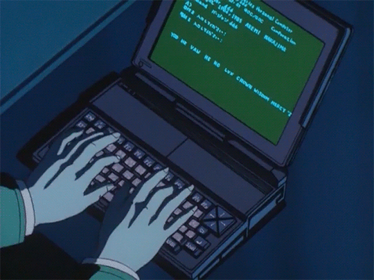

<div align="center">

<!-- First line: Name -->


<!-- Second line: Roles -->


<br>

</div>

---

## ( i ) About Me

<table>
<tr>
<td width="60%" valign="top">

Computer Science undergraduate at **Amrita Vishwa Vidyapeetham**. I build at the intersection of software development, game design, and system architecture. Focused on shipping functional products and learning through execution.

**Current Focus:** Web applications, game development, and open-source tooling

**Approach:** Ship fast, iterate, refine

</td>
<td width="40%" valign="top">



</td>
</tr>
</table>

---

## { } Tech Stack

```cpp
class Developer {
    private:
        vector<string> languages      = {"C++", "Python", "JavaScript", "TypeScript", "C", "Java", "Haskell"};
        vector<string> libraries      = {"Pandas", "NumPy", "Matplotlib", "Seaborn"};
        vector<string> web            = {"HTML/CSS", "React", "Next.js", "Flask", "FastAPI"};
        vector<string> databases      = {"PostgreSQL", "Supabase", "Firebase", "MongoDB"};
        vector<string> gamedev        = {"Unity", "Godot", "Blender"};
        vector<string> devops_cloud   = {"Docker", "Kubernetes", "Linux", "Bash"};
        vector<string> tools          = {"Git", "GitHub", "Postman", "Neovim"};

    public:
        string current_status = "Building SneakerNet & jamr.io";
        string learning       = "Advanced algorithms & system design";

        void code() {
            while (true) {
                learn();
                build();
                ship();
            }
        }
};
```

<br>

---

## [>] Projects

<table>
<tr>
<td width="50%" valign="top">

**SneakerNet** — Sneaker intelligence platform that aggregates pricing across marketplaces to help users discover fair value, track resale trends, and make informed buy or sell decisions. Built with a scalable backend and ML-ready architecture for future personalization and analytics.

`Next.js` `FastAPI` `PostgreSQL` `Web Scraping` `Machine Learning`

</td>
<td width="50%" valign="top">

**jamr.io** — Real-time music matchmaking platform that connects users into Spotify Jam rooms based on shared listening taste. Users are matched via audio-feature similarity, join live chat rooms, and hop into Spotify Jams through invite links.

`Next.js` `FastAPI` `Spotify Web API` `WebSockets` `PostgreSQL` `scikit-learn` `TypeScript`

</td>
</tr>

<tr>
<td width="50%" valign="top">

**Typing Tester** — Speed typing game with moving targets. Built to improve typing accuracy and speed through gamification.

`JavaScript` `Canvas API`

</td>
<td width="50%" valign="top">

**Image to ASCII** — Efficient C utility for converting images to ASCII art. Optimized for terminal output and file processing.

`C` `Image Processing`

</td>
</tr>

<tr>
<td colspan="2" valign="top">

**Eidothea** — Knowledge archive and community platform for creepypastas, SCP lore, cryptids, and real-life mysteries. Designed with structured lore entries and discussion threads so users can explore canon information while sharing theories and interpretations.

`FastAPI` `Python` `Web Development` `Community Systems`

</td>
</tr>
</table>

<br>

---

## [#] GitHub Stats

<div align="center">

<table style="border: 1px solid #7C3AED; border-radius: 8px; overflow: hidden; background-color: #0d0014;">
<tr>
<td align="center" colspan="2" style="padding: 16px; border-bottom: 1px solid #1a0030;">

</td>
</tr>
<tr>
<td align="center" width="50%" style="padding: 16px;">

</td>
<td align="center" width="50%" style="padding: 16px;">

</td>
</tr>
</table>

</div>


---


## [~] Contribution Graph

<div align="center">


</div>

<br>

---

## " " Random Dev Quote

<div align="center">


</div>

<br>

---

## [*] Principles

```bash
$ cat approach.txt

├─ Execution over planning
├─ Iteration over perfection
├─ Shipping over theorizing
└─ Learning through building

$ uptime
Building systems, solving problems, writing code.
```

<br>

---

## [@] Connect

<div align="center">

[](https://github.com/Sukanth19)
[](mailto:sukan3066@gmail.com)
[](https://discord.com/users/zynk__19)

<br>


</div>

---

<div align="center">
<sub>Last updated: 2026</sub>
</div>
